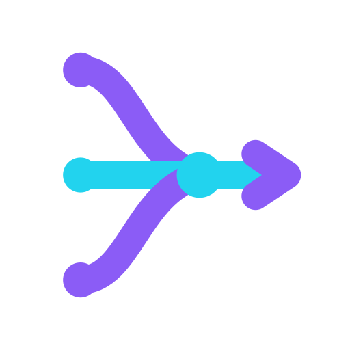
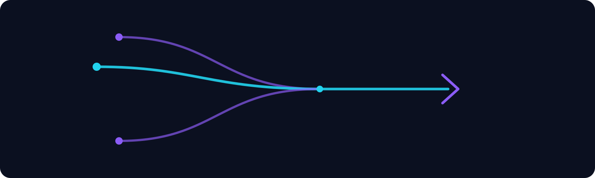
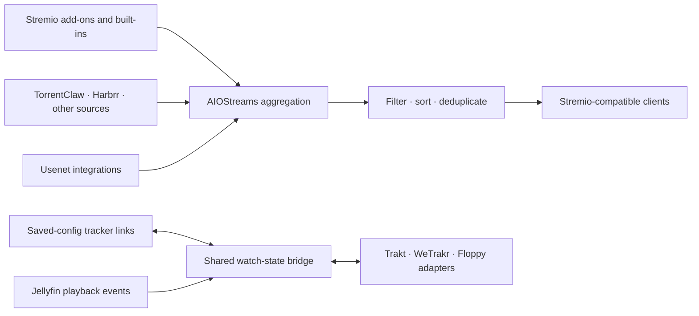
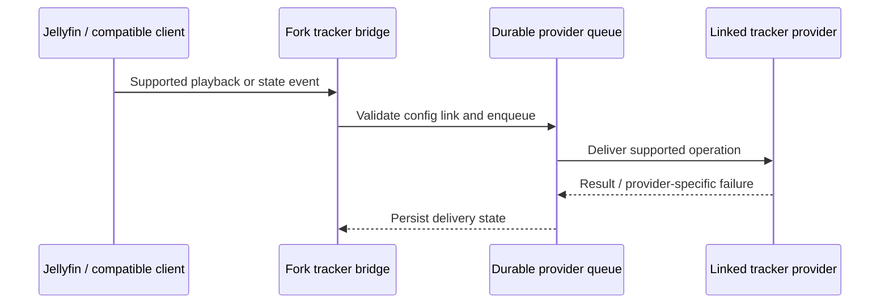
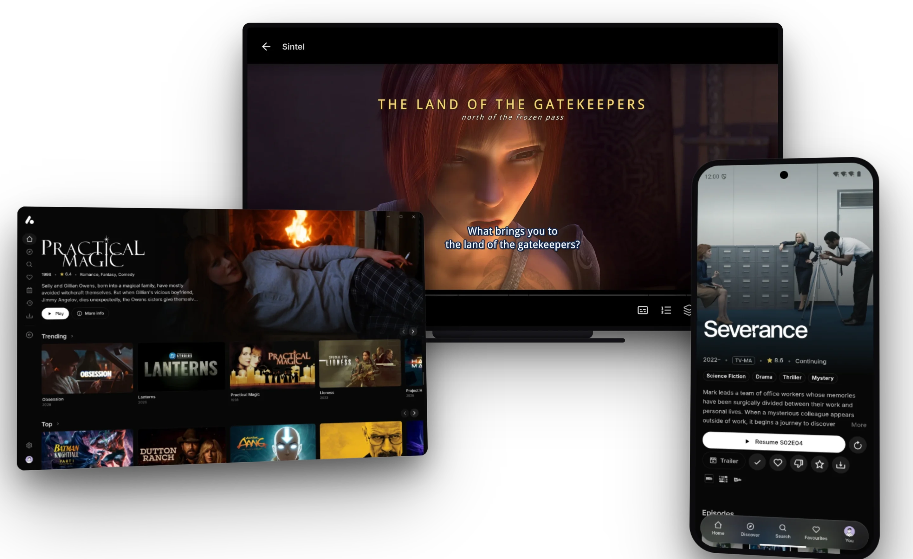
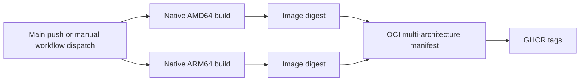

<p align="center">
  
</p>

<h1 align="center">AIOStreams · Cxsmo fork</h1>

<p align="center">
  <strong>One Stremio addon. Your sources, your trackers, one watch state.</strong>
  <br />
  The upstream AIOStreams experience, extended with linked tracker providers,
  Jellyfin tracker sync, and additional search and Usenet integrations.
</p>

<p align="center">
  
</p>

<p align="center">
  <a href="https://github.com/Cxsmo-ai/AIOStreams/actions/workflows/build.yml"></a>
  <a href="https://github.com/Cxsmo-ai/AIOStreams/actions/workflows/deploy-docker.yml"></a>
  <a href="https://github.com/Cxsmo-ai/AIOStreams/pkgs/container/aiostreams"></a>
  <a href="LICENSE"></a>
</p>

<p align="center"><sub>Independent community fork. The artwork above is original to this fork; it is not the official AIOStreams logo.</sub></p>

<p align="center">
  <a href="#at-a-glance">At a glance</a> ·
  <a href="#what-this-fork-adds">Fork additions</a> ·
  <a href="#tracker-accounts-and-isolation">Tracker isolation</a> ·
  <a href="#container-images-and-architectures">Container images</a> ·
  <a href="#build-from-source">Build from source</a>
</p>

> **A community-maintained fork of [Viren070/AIOStreams](https://github.com/Viren070/AIOStreams).** The upstream project remains the source of the core AIOStreams application. This repository adds the fork-specific integrations described below; it is not an official upstream release, and upstream and fork capabilities are called out separately.

## At a glance

AIOStreams brings multiple Stremio addons and supported services behind one configurable addon. It gathers their streams, then applies shared filtering, sorting, deduplication, and formatting. This fork keeps that upstream foundation and adds a set of optional integrations for operators who want tracker accounts, Jellyfin playback sync, and more search/indexer choices.

| Area                | Official AIOStreams foundation                                                          | Added in this fork                                                                                    |
| ------------------- | --------------------------------------------------------------------------------------- | ----------------------------------------------------------------------------------------------------- |
| Stremio aggregation | Addon marketplace, built-ins, catalogs, filters, sorting, formatting, and proxy options | Additional built-in search/indexer integrations and TorrentClaw-specific handling                     |
| Watching apps       | AIOStreams web, desktop, mobile/TV, and Jellyfin-compatible app experience              | Jellyfin playback and supported tracker state are bridged through the fork's tracker layer            |
| Watch state         | Upstream Watch State protocol for compatible addons                                     | Direct Trakt, WeTrakr, and Floppy account links, provider sync, and durable cross-provider delivery   |
| Usenet              | Upstream Usenet engine and supported services                                           | Newshosting and Unarr indexer integrations, ordered NNTP fallback tiers, and related quota safeguards |
| Fork-specific work  | Upstream release process and multi-platform images                                      | Tracker/Jellyfin integrations, extra sources, and this fork's GHCR tag/build pipeline                 |

### How the fork fits together

The fork keeps the upstream aggregation path intact and adds optional provider-specific adapters around it. Tracker credentials remain linked to a saved AIOStreams configuration; they are not copied into this repository or a shareable manifest.



<details>
<summary>What the tracker bridge does (and does not promise)</summary>



Provider APIs do not expose identical operations. Unsupported operations and partial failures must remain visible as such; a provider failure is not equivalent to an empty watch history.

</details>

For the complete upstream feature set and official usage guides, see the [upstream README](https://github.com/Viren070/AIOStreams#readme) and [AIOStreams documentation](https://docs.aiostreams.viren070.me). The comparison here was checked against upstream `main` at [`89312b5`](https://github.com/Viren070/AIOStreams/commit/89312b535f7e1eda9c81b1f0de3b62730bd7e22e) on 2026-10-22; upstream may since have adopted or changed individual integrations. This fork can lag upstream or carry incompatible changes, so check this repository's branch and build status before upgrading a deployment.

## What this fork adds

These are fork-specific additions, not claims about official AIOStreams. Integrations are optional and can depend on each provider's own account, API, plan, and feature support.

### Linked trackers and Jellyfin sync

- **Trakt, WeTrakr, and Floppy links** are configured from the AIOStreams **Services → Trackers** area. Each saved AIOStreams configuration links its own provider account; credentials are kept server-side and are not part of shareable addon configuration.
- **Merged tracker delivery** routes supported watch-state and playback changes through provider adapters. WeTrakr change-journal support and provider snapshots are reconciled with a durable queue; provider-specific partial failures are tracked instead of being treated as an empty history.
- **Jellyfin tracker bridge** connects Jellyfin-originated playback and supported rating/list state with the linked tracker layer. A provider only receives operations its adapter and API support; unsupported or rejected operations are not represented as successfully synced.
- **Relink protection** associates queued work and sync checkpoints with the active provider link generation. Relinking or disconnecting a provider prevents stale queued work from being sent to the replacement account.
- **Account scope matters:** tracker links belong to a saved AIOStreams configuration, not automatically to each Jellyfin household profile. Household profiles and saved configurations are different boundaries. Do not expect a household profile to have an independent direct tracker account unless that behavior is explicitly implemented for the provider.

The upstream [Watch State protocol](https://docs.aiostreams.viren070.me/reference/addon-protocol/watch-state) is separate from these direct tracker links. Provider APIs differ, so “merged” does not mean every provider supports every operation or field.

### Additional discovery and Usenet tools

- **TorrentClaw**: built-in source integration with TorrentClaw-specific result handling, metadata/catalog support where configured, and optional resolution through compatible services.
- **TorrentClaw Unarr (index-only)**: uses Unarr for NZB discovery while playback is handled by the selected AIOStreams Usenet service. Optional quota controls are available.
- **Newshosting indexer**: native account-backed search and NZB handoff to supported AIOStreams Usenet playback paths.
- **Harbrr**: an additional built-in source integration.
- **Ordered NNTP fallback tiers**: a primary provider can be followed by explicitly ordered emergency tiers; older `isBackup` settings are mapped for compatibility.
- **Addon performance aggregates**: daily source-level metrics help compare latency and result outcomes without storing request titles, media IDs, stream URLs, IP addresses, or credentials in the aggregate rows.

### Request and sync hardening

The fork also adds URL/request validation and redirect controls, stronger authentication/CORS handling, and generation-aware tracker queues. These changes reduce specific request and stale-sync risks; they are not a security guarantee. Operators should still protect the configuration and manifest endpoints, keep instance secrets private, and use network-level controls appropriate to their deployment.

## AIOStreams application

The following is the AIOStreams application montage already included in this repository. It illustrates the shared app experience and does not show private configuration or account data.

<p align="center">
  
</p>

Explore the upstream project's [application overview](https://docs.aiostreams.viren070.me) for current clients and capabilities. This fork's custom integrations are described separately above; the image does not imply that each fork-only feature appears in every client.

## Tracker accounts and isolation

Configure a provider separately in each saved AIOStreams configuration that should use it:

| Provider    | Account setup                                                  | Isolation behavior                                                                                  |
| ----------- | -------------------------------------------------------------- | --------------------------------------------------------------------------------------------------- |
| **Floppy**  | Your Floppy server address and API token                       | Token is validated and encrypted in server-side storage; the saved config holds an opaque reference |
| **Trakt**   | Configuration-specific Trakt app credentials and authorization | Linked tokens are stored server-side and resolved for the matching saved config                     |
| **WeTrakr** | Your WeTrakr app credentials and account authorization         | Link and live-sync state are associated with the authorizing saved config                           |

On relink, provider-specific checkpoints and queued writes are fenced from the old account. The shared AIOStreams watch-state ledger is retained; it is not the same thing as sharing one provider login between saved configurations.

Never publish API keys, OAuth tokens, configuration passwords, private manifest URLs, or real `.env` files in this repository, screenshots, issues, or examples. Use placeholders in public examples and rotate any credential that has been exposed.

## Getting started

1. Start from the [official deployment guide](https://docs.aiostreams.viren070.me/getting-started/deployment) and use this fork's container image if you want the additions above.
2. Open `/stremio/configure` on your own instance and configure your sources and services.
3. Save a configuration and install its manifest in your Stremio-compatible client. Keep each saved configuration's UUID/password pair private.
4. To use the fork's direct tracker integrations, open **Services → Trackers** and link the accounts that belong to that saved configuration.

This repository does not bundle a maintainer's provider accounts, API keys, or personal instance configuration. You supply and manage credentials for your own deployment. For upstream AIOStreams application setup, use the [official docs](https://docs.aiostreams.viren070.me).

## Container images and architectures

The fork publishes to GitHub Container Registry:

```text
ghcr.io/cxsmo-ai/aiostreams:<tag>
```

For example, Podman or Docker can pull the rolling `latest` tag:

```sh
podman pull ghcr.io/cxsmo-ai/aiostreams:latest
# or
docker pull ghcr.io/cxsmo-ai/aiostreams:latest
```

The `deploy-docker.yml` and `dev-docker.yml` workflows build **separate native images** for `linux/amd64` and `linux/arm64`, upload their digests, and publish a combined multi-platform manifest. The ARM64 job uses an ARM runner; the workflow does not need QEMU emulation. Container clients select the matching architecture from the manifest when pulling. Upstream AIOStreams also publishes multi-platform images; this section documents how this fork builds and tags its own images, not an exclusive architecture feature.



| Workflow                           | Trigger                                                   | Published tags                                                                                                       |
| ---------------------------------- | --------------------------------------------------------- | -------------------------------------------------------------------------------------------------------------------- |
| **Build and Deploy Docker Images** | Push to `main`                                            | `latest` and `main-<short-sha>`; the build metadata channel is `nightly`                                             |
| **Build and Deploy Docker Images** | Manual dispatch with a version ref                        | Stable `vX.Y.Z` or nightly `X.Y.Z-nightly`; stable aliases may also be published when the version resolves to `main` |
| **Dev Docker Image**               | Manual dispatch with a branch name or pull-request number | A sanitized branch tag or `pr-<number>`; an optional tag can override it                                             |

`latest` is a mutable tag: main pushes publish a rolling build with nightly metadata, and a qualifying manual stable release can also update it when its version ref resolves to `main`. Development builds reject protected release tags. Check the [container workflow](https://github.com/Cxsmo-ai/AIOStreams/actions/workflows/deploy-docker.yml), [development image workflow](https://github.com/Cxsmo-ai/AIOStreams/actions/workflows/dev-docker.yml), and [GHCR package](https://github.com/Cxsmo-ai/AIOStreams/pkgs/container/aiostreams) for current runs and available tags. The PR build workflow checks code; it does not publish a production image.

## Build from source

The current project metadata requires Node.js 24 or newer and pnpm 11 or newer. With Corepack enabled:

```sh
corepack enable
pnpm install --frozen-lockfile
pnpm run build
```

To build a native ARM64 image with Podman on an ARM64 Linux host:

```sh
podman build --arch arm64 --os linux -t localhost/aiostreams:local .
```

Do not pass `--arch arm64` on an x86 host unless native cross-building is correctly configured; the production GitHub workflow uses an ARM runner for the ARM64 image. The Docker build uses the lockfile and compiles native dependencies for the target architecture.

## Upstream, licensing, and contributions

This fork is based on [Viren070/AIOStreams](https://github.com/Viren070/AIOStreams) and retains its upstream attribution. Shared improvements that belong in the core project should be proposed upstream; fork-specific integration issues can be filed in this repository. Because upstream and this fork evolve independently, a successful upstream build or release does not automatically validate this fork's custom tracker or provider paths.

The project is distributed under **AGPL-3.0-only**; see [`LICENSE`](LICENSE). AIOStreams aggregates sources supplied by users and does not host or distribute media. Users and operators are responsible for complying with applicable law and the terms of services they configure.

### Useful links

- [Official AIOStreams repository](https://github.com/Viren070/AIOStreams)
- [Official documentation](https://docs.aiostreams.viren070.me)
- [Fork actions](https://github.com/Cxsmo-ai/AIOStreams/actions)
- [Fork container package](https://github.com/Cxsmo-ai/AIOStreams/pkgs/container/aiostreams)
- [License](LICENSE)
