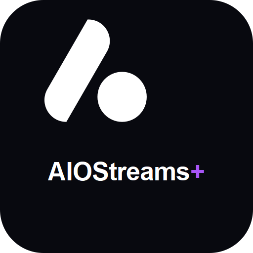
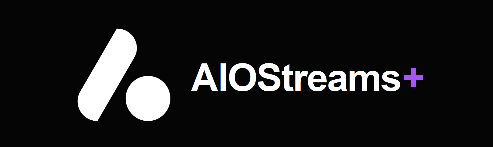
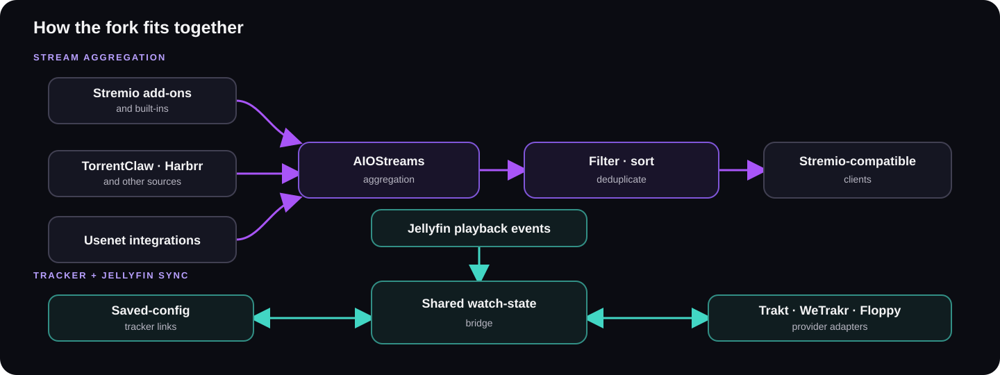
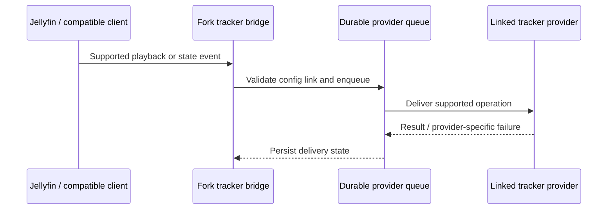
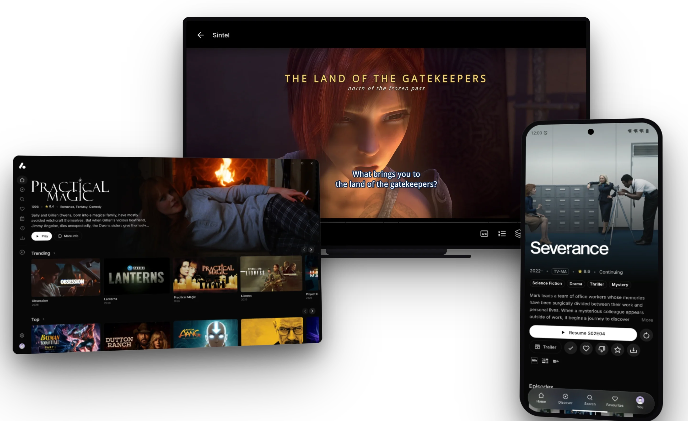
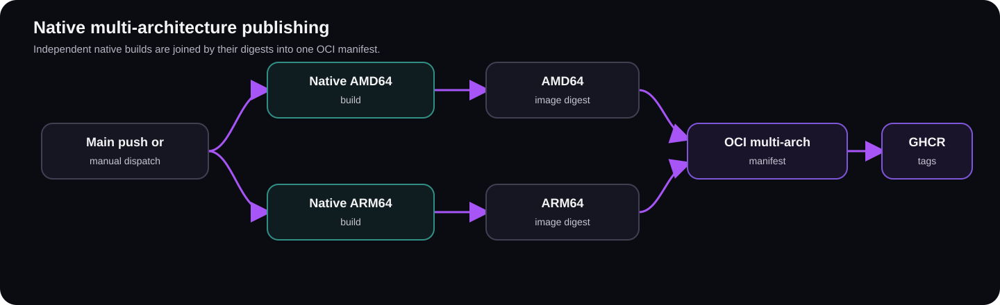

<p align="center">
  
</p>

<h1 align="center">AIOStreams · Cxsmo fork</h1>

<p align="center">
  <strong>One Stremio addon. Your sources, your trackers, one watch state.</strong>
  <br />
  The upstream AIOStreams experience, extended with linked tracker providers,
  Jellyfin tracker sync, and additional search and Usenet integrations.
</p>

<p align="center">
  
</p>

<p align="center">
  <a href="https://github.com/Cxsmo-ai/AIOStreams/actions/workflows/build.yml"></a>
  <a href="https://github.com/Cxsmo-ai/AIOStreams/actions/workflows/deploy-docker.yml"></a>
  <a href="https://github.com/Cxsmo-ai/AIOStreams/pkgs/container/aiostreams"></a>
  <a href="LICENSE"></a>
</p>

<p align="center"><sub>Independent community fork with fork-specific artwork; this is not an official upstream release.</sub></p>

<p align="center">
  <a href="#at-a-glance">At a glance</a> ·
  <a href="#what-this-fork-adds">Fork additions</a> ·
  <a href="#tracker-accounts-and-isolation">Tracker isolation</a> ·
  <a href="#container-images-and-architectures">Container images</a> ·
  <a href="#build-from-source">Build from source</a>
</p>

> **A community-maintained fork of [Viren070/AIOStreams](https://github.com/Viren070/AIOStreams).** The upstream project remains the source of the core AIOStreams application. This repository adds the fork-specific integrations described below; it is not an official upstream release, and upstream and fork capabilities are called out separately.

## At a glance

AIOStreams brings multiple Stremio addons and supported services behind one configurable addon. It gathers their streams, then applies shared filtering, sorting, deduplication, and formatting. This fork keeps that upstream foundation and adds a set of optional integrations for operators who want tracker accounts, Jellyfin playback sync, and more search/indexer choices.

| Area                | Official AIOStreams foundation                                                          | Added in this fork                                                                                    |
| ------------------- | --------------------------------------------------------------------------------------- | ----------------------------------------------------------------------------------------------------- |
| Stremio aggregation | Addon marketplace, built-ins, catalogs, filters, sorting, formatting, and proxy options | Additional built-in search/indexer integrations and TorrentClaw-specific handling                     |
| Watching apps       | AIOStreams web, desktop, mobile/TV, and Jellyfin-compatible app experience              | Jellyfin playback and supported tracker state are bridged through the fork's tracker layer            |
| Watch state         | Upstream Watch State protocol for compatible addons                                     | Direct Trakt, WeTrakr, and Floppy account links, provider sync, and durable cross-provider delivery   |
| Usenet              | Upstream Usenet engine and supported services                                           | Newshosting and Unarr indexer integrations, ordered NNTP fallback tiers, and related quota safeguards |
| Fork-specific work  | Upstream release process and multi-platform images                                      | Tracker/Jellyfin integrations, extra sources, and this fork's GHCR tag/build pipeline                 |

### How the fork fits together

The fork keeps the upstream aggregation path intact and adds optional provider-specific adapters around it. Tracker credentials remain linked to a saved AIOStreams configuration; they are not copied into this repository or a shareable manifest.

[](docs/diagrams/fork-architecture.svg)

[View editable Mermaid source](docs/diagrams/fork-architecture.mmd).

<details>
<summary>What the tracker bridge does (and does not promise)</summary>



Provider APIs do not expose identical operations. Unsupported operations and partial failures must remain visible as such; a provider failure is not equivalent to an empty watch history.

</details>

For the complete upstream feature set and official usage guides, see the [upstream README](https://github.com/Viren070/AIOStreams#readme) and [AIOStreams documentation](https://docs.aiostreams.viren070.me). The comparison here was checked against upstream `main` at [`89312b5`](https://github.com/Viren070/AIOStreams/commit/89312b535f7e1eda9c81b1f0de3b62730bd7e22e) on 2026-10-22; upstream may since have adopted or changed individual integrations. This fork can lag upstream or carry incompatible changes, so check this repository's branch and build status before upgrading a deployment.

## What this fork adds

The items below describe fork-specific code in this repository; they are not claims that every item is part of official AIOStreams. Most integrations are optional and require your own provider account, API access, and compatible client. Provider APIs are not interchangeable, so support is capability-based rather than a promise of identical behavior everywhere.

### Tracker accounts, merged state, and sync

- **Direct tracker links:** Trakt, WeTrakr, and Floppy can be linked from **Services → Trackers**. Each saved AIOStreams configuration has its own provider link. Credentials and OAuth tokens stay in server-side storage; shareable addon configuration contains references, not the credentials themselves.
- **A common record model:** provider records are normalized around media identity and supported state such as watched history, in-progress playback, ratings, watchlists/custom lists, comments/reactions, and removals. Movie/show/episode identity, episode coordinates, progress, and provider timestamps are retained when supplied. Each adapter only reads or writes fields the provider API actually supports.
- **Live delivery and backfill:** supported playback changes can be queued for provider delivery; the tracker panel also exposes provider linking and sync controls, including WeTrakr backfill/merge and live-sync controls. Tracker writes and live scrobbles use separate durable queues with bounded batches, leases, retries, and generation checks. A locally accepted change is not proof of immediate remote delivery; unsupported operations are reported separately, and provider polling, journals, and API limits differ.
- **WeTrakr:** account snapshots are read by independently tracked facets, with paginated history/list/comment data and an incremental change-journal checkpoint where available. Supported list and comment writes/reactions are provider-specific. The configuration UI also includes WeTrakr account/catalog browsing and search tools. A failed facet is reported separately rather than converted into an empty account snapshot.
- **Floppy:** the adapter pages through account playback, history, library/list, and rating data where returned by its API. A snapshot is accepted only when its required pages and facets parse successfully, preventing an incomplete read from being treated as authoritative absence.
- **Trakt:** the adapter maps supported history, watchlist, rating, and live scrobble operations to Trakt's own API endpoints. Provider-specific operation support still applies.
- **Durable delivery and relink safety:** tracker work is stored in an outbox with retry/checkpoint state. Link generations fence old queued work after relink or disconnect, so a stale job is not silently sent to a newly linked account. Partial-provider failures remain visible and do not erase another provider's history.
- **Important scope boundary:** these links belong to a saved AIOStreams configuration. A Jellyfin household user/profile is not automatically a separate set of direct tracker credentials. The Jellyfin bridge also skips non-primary personas; their activity is not automatically written to the primary account's linked trackers. The upstream [Watch State protocol](https://docs.aiostreams.viren070.me/reference/addon-protocol/watch-state) is distinct from the fork's direct provider links.

### Jellyfin playback and tracker bridge

- The fork's Jellyfin bridge maps supported Jellyfin playback events into the shared watch-state/tracker path, including progress and completion/scrobble events. Rating and list changes are forwarded only when the incoming operation and linked provider adapter support them.
- Provider records are normalized using available external IDs and episode season/episode numbers before they enter the shared ledger. This reduces mismatches between provider IDs; records without a safe identity are not guessed into a different title.
- Queue delivery is associated with the relevant saved configuration and provider link generation. A rejected or unsupported write is reported as a failure/unsupported operation rather than a successful sync.
- The fork also includes Jellyfin playback-info efficiency work: version-list requests can defer external subtitle-addon lookup until a playback source is selected. This does not change Jellyfin's subtitle provider or convert subtitles globally.

### Search, catalog, and metadata additions

- **TorrentClaw:** a configurable built-in source with provider-aware stream parsing, paginated candidate collection, supported-service routing, metadata/catalog enrichment where enabled, and safer merging with other results. Optional handling can repair known metadata-ID mismatches, inspect season-pack episode sizes, retain source/quality indicators supplied by TorrentClaw, pin its results, or preserve its results through final filtering. These options do not manufacture a TrueSpec verification or guarantee a playable result.
- **Enhanced Cinemeta:** a Stremio-compatible metadata/catalog route keeps Cinemeta as the base and can add TorrentClaw season/episode metadata when the saved configuration has the relevant service enabled. If enrichment is unavailable or fails, the route falls back to the underlying Cinemeta response; this is metadata enrichment, not a replacement playback source. The separately listed configurable Cinemeta preset below is an upstream compatibility backport, not the source of this TorrentClaw enrichment.
- **Harbrr (torrent-only in this fork):** searches selected public/private torrent indexers with source filtering, expanded queries, deduplication, and torrent download/magnet handling. The Harbrr API supports Usenet, but this AIOStreams integration intentionally returns no NZB results.
- **Newshosting indexer:** a native account-backed search path that can create/hand off NZB content to configured compatible Usenet services. Credentials are supplied by the operator; the addon does not bundle an account.
- **Unarr indexer:** an index-only discovery integration. Unarr finds NZB results; a separately selected compatible AIOStreams Usenet service handles playback. Optional quota/reservation controls avoid treating indexer discovery as a second playback engine.
- **Newznab SearchNZB compatibility:** recognizes the optional SearchNZB endpoint when an indexer advertises it.
- **Meteor cleanup:** removes known provider placeholder/no-results entries so support links and empty-result cards do not masquerade as media streams.

### Deepbrid Usenet Finder and player delivery

- **Finder routing is separate from playback transport.** Finder mode can be **Direct Resolve** (keep Finder-resolved playback), **Indexer Only** (route Finder NZB handoffs when the API supplies an NZB URL), or **Both** (keep Finder playback and enable that optional external-Usenet handoff). Other indexer addons have their own service-routing settings; Finder results do not automatically become NZBs when the upstream Finder API supplies only a playable file.
- **Result controls:** Finder requests support pagination, bounded retries/deadlines, per-addon and shared concurrency limits, and cached/in-flight request reuse. A result or content-resolve limit of `0` means unlimited candidates for that configured limit; network concurrency and timeouts remain bounded. The “Always Keep Results” option protects returned Deepbrid results from final result filtering/limits, but cannot create results when the provider has none or the request fails.
- **Progressive responses:** the opt-in `/:type/:id.ndjson` route is for a compatible modified Nuvio client. It sends a hello event, cumulative snapshots, and a final authoritative response when delivered successfully; heartbeats, backpressure, and disconnect detection/cleanup are separate from the ordinary Stremio JSON route. Deepbrid's progressive resolver merges already-validated early results with the final Finder results by stable candidate identity, rather than depending on encrypted playback-URL equality. A disconnected client is not guaranteed to receive the terminal event.
- **Player delivery choices:** each Finder result can use a native/direct byte-range proxy, Deepbrid **Remux**, **HLS**, or all three as separately labeled choices. Native playback capabilities are signed, encrypted, time-limited, and checked against allowed download hosts by the server. This is a delivery choice after resolution, not a Finder search mode or a promise that every player supports every transport equally.
- **Deepbrid OpenSubtitles built-in:** an optional universal subtitle addon resolves a title from metadata/IMDb-style IDs, searches selected languages, supports hearing-impaired filters and a per-query result cap, and returns subtitle tracks through an AIOStreams WebVTT download proxy. This is a separate subtitle addon—not the player-side conversion toggle below.
- **Optional subtitle conversion:** a per-addon toggle can send eligible ASS/SSA/SUB tracks from other subtitle addons through the Deepbrid player converter as WebVTT. OpenSubtitles/Deepbrid OpenSubtitles sources are excluded; SRT and WebVTT are passed through unchanged.

### Reliability, security, and operations

- **Ordered NNTP fallback tiers:** explicitly ordered secondary Usenet providers can be used as fallback tiers; legacy `isBackup` configuration is migrated for compatibility.
- **Unlimited result-cap controls:** the filter UI offers a “set all limits to 0” action and treats zero/blank caps as unlimited across global, service, addon, resolution, quality, indexer, and release-group result limits. This changes final result caps; it does not remove provider limits, request deadlines, or concurrency safeguards.
- **Source performance aggregates:** daily per-addon counters cover requests, result/error/cutoff outcomes, latency, stream sizes, cache state, and source categories. Aggregate entities use a one-way manifest-instance hash; those aggregate tables do not contain media titles, media IDs, stream URLs, client IP addresses, or credentials. This describes the aggregate tables, not every application log or database.
- **Deepbrid diagnostics:** progressive failure details and stage counters use bounded, allowlisted fields rather than exposing raw provider URLs, signed download links, or arbitrary error bodies.
- **Request hardening:** URL validation, redirect controls, bounded fetching, and authentication/CORS protections reduce specific SSRF, credential-handling, and stale-request risks. They are defense-in-depth, not a security guarantee; operators must still protect configuration/manifest access and private service credentials.
- **ARM64 and release automation:** this fork's GHCR workflows publish distinct native AMD64 and ARM64 builds and combine their digests into multi-platform tags. The build pipeline and tags are detailed under [Container images and architectures](#container-images-and-architectures).

### Selected upstream compatibility backports

The fork also carries focused changes from newer official AIOStreams source where they fit the custom integrations above:

- **Cinemeta preset:** configurable metadata/catalog endpoint and timeout options.
- **Newznab SearchNZB discovery:** recognizes the optional SearchNZB endpoint.
- **Meteor placeholder filtering:** ignores provider no-results/support-link entries.
- **Jellyfin version-list efficiency:** can skip subtitle-addon work until the chosen source is requested.
- **Metadata corrections:** avoids assigning indexer-quality metadata when language data is absent and recognizes additional Chinese language aliases.

These are selective compatibility backports, not a wholesale merge of every upstream architectural or client change. See the [official AIOStreams repository](https://github.com/Viren070/AIOStreams) and [release history](https://github.com/Viren070/AIOStreams/releases) for upstream changes outside this fork's compatibility set.

## AIOStreams application

The following is the AIOStreams application montage already included in this repository. It illustrates the shared app experience and does not show private configuration or account data.

<p align="center">
  
</p>

Explore the upstream project's [application overview](https://docs.aiostreams.viren070.me) for current clients and capabilities. This fork's custom integrations are described separately above; the image does not imply that each fork-only feature appears in every client.

## Tracker accounts and isolation

Configure a provider separately in each saved AIOStreams configuration that should use it:

| Provider    | Account setup                                                  | Isolation behavior                                                                                  |
| ----------- | -------------------------------------------------------------- | --------------------------------------------------------------------------------------------------- |
| **Floppy**  | Your Floppy server address and API token                       | Token is validated and encrypted in server-side storage; the saved config holds an opaque reference |
| **Trakt**   | Configuration-specific Trakt app credentials and authorization | Linked tokens are stored server-side and resolved for the matching saved config                     |
| **WeTrakr** | Your WeTrakr app credentials and account authorization         | Link and live-sync state are associated with the authorizing saved config                           |

On relink, provider-specific checkpoints and queued writes are fenced from the old account. The shared AIOStreams watch-state ledger is retained; it is not the same thing as sharing one provider login between saved configurations.

Never publish API keys, OAuth tokens, configuration passwords, private manifest URLs, or real `.env` files in this repository, screenshots, issues, or examples. Use placeholders in public examples and rotate any credential that has been exposed.

## Getting started

1. Start from the [official deployment guide](https://docs.aiostreams.viren070.me/getting-started/deployment) and use this fork's container image if you want the additions above.
2. Open `/stremio/configure` on your own instance and configure your sources and services.
3. Save a configuration and install its manifest in your Stremio-compatible client. Keep each saved configuration's UUID/password pair private.
4. To use the fork's direct tracker integrations, open **Services → Trackers** and link the accounts that belong to that saved configuration.

This repository does not bundle a maintainer's provider accounts, API keys, or personal instance configuration. You supply and manage credentials for your own deployment. For upstream AIOStreams application setup, use the [official docs](https://docs.aiostreams.viren070.me).

## Container images and architectures

The fork publishes to GitHub Container Registry:

```text
ghcr.io/cxsmo-ai/aiostreams:<tag>
```

For example, Podman or Docker can pull the rolling `latest` tag:

```sh
podman pull ghcr.io/cxsmo-ai/aiostreams:latest
# or
docker pull ghcr.io/cxsmo-ai/aiostreams:latest
```

The `deploy-docker.yml` and `dev-docker.yml` workflows build **separate native images** for `linux/amd64` and `linux/arm64`, upload their digests, and publish a combined multi-platform manifest. The ARM64 job uses an ARM runner; the workflow does not need QEMU emulation. Container clients select the matching architecture from the manifest when pulling. Upstream AIOStreams also publishes multi-platform images; this section documents how this fork builds and tags its own images, not an exclusive architecture feature.

[](docs/diagrams/docker-publishing.svg)

[View editable Mermaid source](docs/diagrams/docker-publishing.mmd).

| Workflow                           | Trigger                                                   | Published tags                                                                                                       |
| ---------------------------------- | --------------------------------------------------------- | -------------------------------------------------------------------------------------------------------------------- |
| **Build and Deploy Docker Images** | Push to `main`                                            | `latest` and `main-<short-sha>`; the build metadata channel is `nightly`                                             |
| **Build and Deploy Docker Images** | Manual dispatch with a version ref                        | Stable `vX.Y.Z` or nightly `X.Y.Z-nightly`; stable aliases may also be published when the version resolves to `main` |
| **Dev Docker Image**               | Manual dispatch with a branch name or pull-request number | A sanitized branch tag or `pr-<number>`; an optional tag can override it                                             |

`latest` is a mutable tag: main pushes publish a rolling build with nightly metadata, and a qualifying manual stable release can also update it when its version ref resolves to `main`. Development builds reject protected release tags. Check the [container workflow](https://github.com/Cxsmo-ai/AIOStreams/actions/workflows/deploy-docker.yml), [development image workflow](https://github.com/Cxsmo-ai/AIOStreams/actions/workflows/dev-docker.yml), and [GHCR package](https://github.com/Cxsmo-ai/AIOStreams/pkgs/container/aiostreams) for current runs and available tags. The PR build workflow checks code; it does not publish a production image.

## Build from source

The current project metadata requires Node.js 24 or newer and pnpm 11 or newer. With Corepack enabled:

```sh
corepack enable
pnpm install --frozen-lockfile
pnpm run build
```

To build a native ARM64 image with Podman on an ARM64 Linux host:

```sh
podman build --arch arm64 --os linux -t localhost/aiostreams:local .
```

Do not pass `--arch arm64` on an x86 host unless native cross-building is correctly configured; the production GitHub workflow uses an ARM runner for the ARM64 image. The Docker build uses the lockfile and compiles native dependencies for the target architecture.

## Upstream, licensing, and contributions

This fork is based on [Viren070/AIOStreams](https://github.com/Viren070/AIOStreams) and retains its upstream attribution. Shared improvements that belong in the core project should be proposed upstream; fork-specific integration issues can be filed in this repository. Because upstream and this fork evolve independently, a successful upstream build or release does not automatically validate this fork's custom tracker or provider paths.

The project is distributed under **AGPL-3.0-only**; see [`LICENSE`](LICENSE). AIOStreams aggregates sources supplied by users and does not host or distribute media. Users and operators are responsible for complying with applicable law and the terms of services they configure.

### Useful links

- [Official AIOStreams repository](https://github.com/Viren070/AIOStreams)
- [Official documentation](https://docs.aiostreams.viren070.me)
- [Fork actions](https://github.com/Cxsmo-ai/AIOStreams/actions)
- [Fork container package](https://github.com/Cxsmo-ai/AIOStreams/pkgs/container/aiostreams)
- [License](LICENSE)
